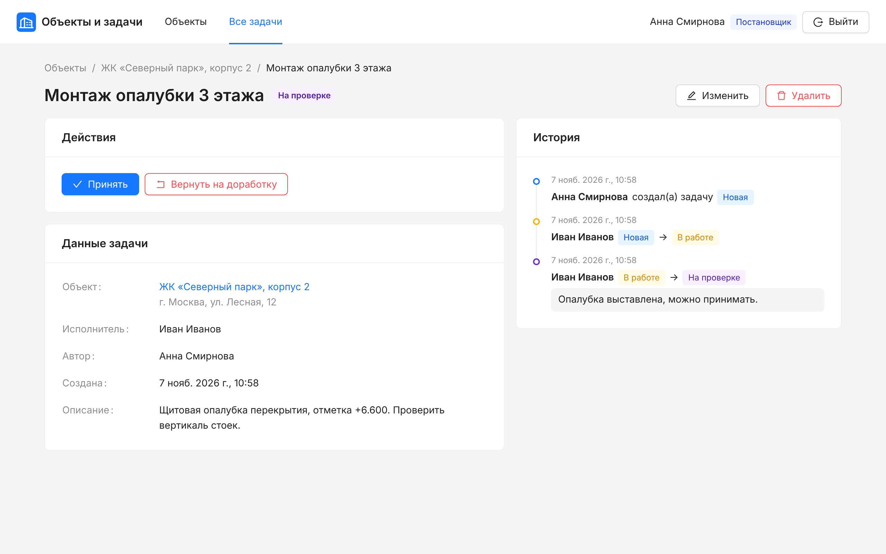
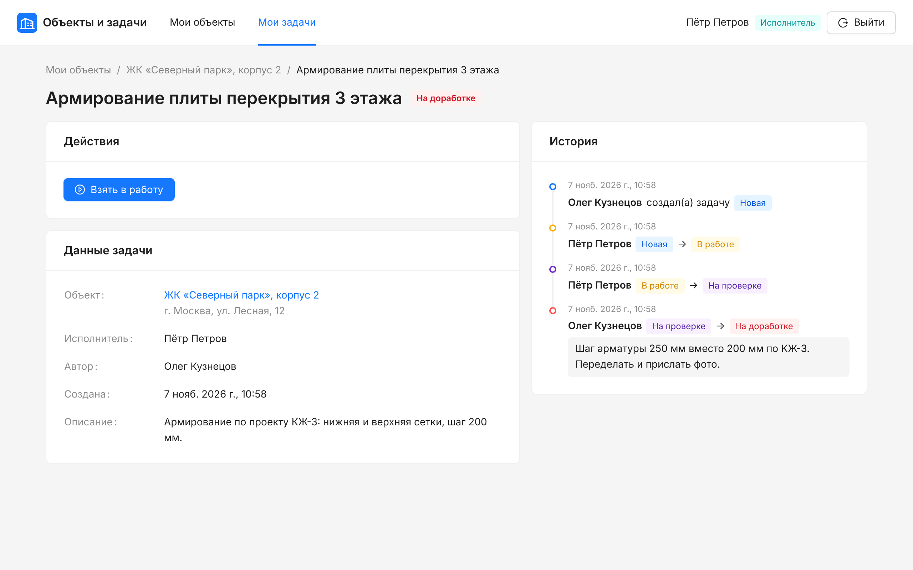
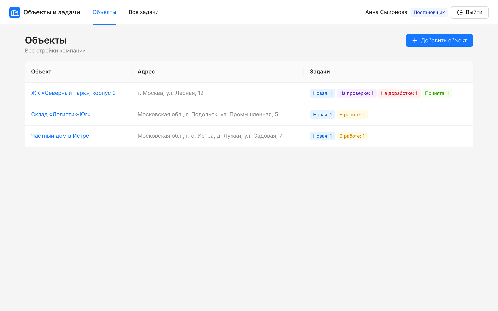
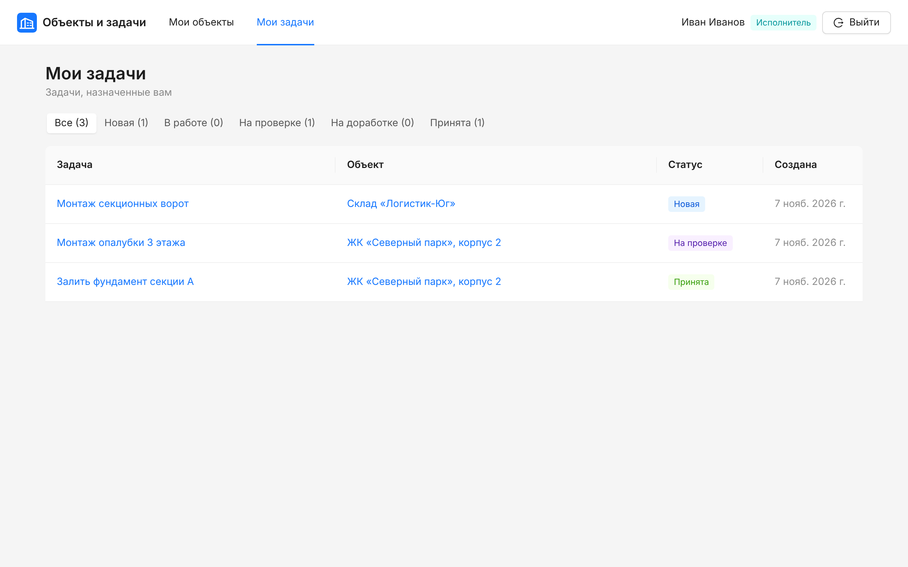

# Мини-CRM «Объекты и задачи»

Тестовое задание: CRM для строительной компании. Постановщик ставит задачи по объектам (стройкам), исполнитель берёт их в работу и отдаёт на проверку, постановщик принимает или возвращает на доработку. Все права доступа и переходы статусов проверяет сама база данных, поэтому они работают и при обращении к Supabase в обход интерфейса.

**Демо:** https://mini-crm-black.vercel.app. Фронтенд на Vercel, Supabase (Postgres, Auth, REST API) работает на собственном сервере в Docker (см. [«Развёртывание»](#развёртывание)). Доступы — в разделе [«Демо-доступы»](#демо-доступы).

**Стек:** React 19 + TypeScript, Vite, Ant Design, TanStack Query, React Router · Supabase (Postgres, Auth, PostgREST).

**Документы для сдачи:**
- [Как устроена система — объяснение для руководителя](docs/EXPLANATION.md)
- [Решения и допущения, что не вошло](docs/DECISIONS.md)

| Постановщик: задача на проверке | Исполнитель: задача вернулась на доработку |
|---|---|
|  |  |
| **Постановщик: все объекты** | **Исполнитель: только свои задачи** |
|  |  |

## Как защищены данные

| Требование | Как сделано |
|---|---|
| Права закрыты на уровне базы | RLS на всех таблицах и `GRANT` по отдельным колонкам. Роль `anon` (запрос без входа) не получает ничего. |
| Исполнитель не читает и не меняет чужие задачи | Политика `tasks_select` отдаёт исполнителю только строки с `assignee_id = auth.uid()`. Менять поля задач может только постановщик. Объекты и историю исполнитель видит только в рамках своих задач, а из сотрудников — себя и постановщиков. По тексту ошибки нельзя даже узнать, существует ли чужой объект. |
| Переходы статусов проверяет база | Единственный путь — функция `change_task_status()`. Она проверяет матрицу `private.task_transitions`, роль и назначение, обязательный комментарий (пробелы и невидимые символы комментарием не считаются) и в той же транзакции пишет историю. Прямой `UPDATE` колонки `status` запрещён правами и триггером — в том числе для секретного ключа `service_role`. |
| Историю нельзя подделать, изменить или удалить | Пишут в неё только функции базы. У ролей API (`anon`, `authenticated` и даже `service_role`) нет прав на запись в историю. Триггер дополнительно отклоняет `UPDATE/DELETE/TRUNCATE` от владельца таблицы — на случай ошибки в коде. Удаление задачи — пометка, история остаётся. |
| Открытая регистрация отключена | Локально — `enable_signup = false` в `supabase/config.toml`, на сервере демо — `GOTRUE_DISABLE_SIGNUP` в `deploy/selfhost/docker-compose.yml`, в Supabase Cloud — настройка в Dashboard (см. ниже). Пользователь без роли не видит ничего: ни задач, ни объектов, ни сотрудников. |
| Секретные ключи не во фронтенде и не в репозитории | Во фронтенд попадают только URL и publishable-ключ (`VITE_*`). Секретный ключ нужен только локальному скрипту сида и берётся из переменной окружения. `.env*` в `.gitignore`. Фронтенд не стартует, если в него по ошибке подставили секретный ключ. Права самого `service_role` урезаны: через API он может только читать данные и заводить профили сотрудников. |

Модель угроз — как в ТЗ: «через API». Администратор базы с прямым SQL-доступом технически может выключить любую защиту внутри Postgres; от этого защищают доступ к самой базе и аудит Supabase, а не код приложения.

Код: [`supabase/migrations/`](supabase/migrations) — три файла: структура, права, жизненный цикл задачи.

**Проверки:**
- `npm run db:test` — 88 тестов pgTAP прямо в базе от имени разных ролей. Проходят и на пустой базе, и с демо-данными.
- `npm run test:api` — 29 попыток обойти правила через HTTP API с публичным ключом. Все должны быть отклонены.

## Запуск локально

Нужны Node.js 22.12+ и Docker.

```bash
npm install
```

```bash
npx supabase start
```

Поднимает локальный Supabase (Postgres, Auth, API) и применяет миграции. Затем покажите ключи:

```bash
npx supabase status
```

Скопируйте `.env.example` в `.env.local` и заполните значениями из `supabase status`: `VITE_SUPABASE_URL` (адрес API), `VITE_SUPABASE_PUBLISHABLE_KEY` (publishable-ключ), `SUPABASE_SECRET_KEY` (secret-ключ, нужен только сиду) и `SEED_PASSWORD` (любой пароль от 8 символов, с буквами и цифрами).

```bash
npm run seed
```

Создаёт сотрудников, 3 объекта и задачи во всех статусах.

```bash
npm run dev
```

Приложение откроется на http://localhost:5173.

Тесты базы (на любой базе — пустой или с демо-данными; всё выполняется в транзакции и откатывается):

```bash
npm run db:test
```

Проверка API (нужны демо-данные; надёжнее всего на свежей базе: `npx supabase db reset`, затем `npm run seed`):

```bash
npm run test:api
```

## Развёртывание

### Как развёрнуто демо: свой сервер + Vercel

Supabase запущен на собственном сервере (AWS Lightsail, Debian 12, 2 ГБ) из официальных образов, и только то, что нужно приложению: Postgres 17, Auth (GoTrue) и REST API (PostgREST). Файлы лежат в [`deploy/selfhost/`](deploy/selfhost). Шлюз Kong заменён на Caddy: он даёт HTTPS (Let's Encrypt), CORS и маршруты `/auth/v1`, `/rest/v1`. Порты контейнеров слушают только `127.0.0.1`, так что база снаружи недоступна, а миграции идут через SSH-туннель.

1. На сервере с Docker и Caddy скопируйте `deploy/selfhost` в `/opt/mini-crm` и создайте секреты. Скрипт генерирует пароль Postgres, JWT-секрет, anon- и service_role-ключи и пишет их в `.env` с правами 600:
   ```bash
   sudo API_HOST=<домен API> SITE_URL=https://<домен фронтенда> bash /opt/mini-crm/make-env.sh
   ```
   ```bash
   cd /opt/mini-crm && sudo docker compose up -d --wait
   ```
2. Подставьте домен API в `deploy/selfhost/Caddyfile`, положите его в `/etc/caddy/conf.d/mini-crm.caddy`, добавьте в `/etc/caddy/Caddyfile` строку `import /etc/caddy/conf.d/*.caddy` и перезагрузите Caddy (`sudo systemctl reload caddy`).
3. Миграции с рабочей машины. Сначала туннель:
   ```bash
   ssh -N -L 15432:127.0.0.1:54322 <user>@<сервер>
   ```
   Затем в другом окне (TLS внутри SSH-туннеля не нужен):
   ```bash
   npx supabase db push --remote="postgresql://postgres:<POSTGRES_PASSWORD>@127.0.0.1:15432/postgres?sslmode=disable"
   ```
4. Тесты pgTAP в базе на сервере:
   ```bash
   ssh <user>@<сервер> 'cd /opt/mini-crm && sudo docker compose exec -T db psql -U postgres -X -q -t -A -v ON_ERROR_STOP=1 -f -' < supabase/tests/database/security.test.sql
   ```
5. Сид — как в шаге 4 для Supabase Cloud ниже: `VITE_SUPABASE_URL=https://<домен API>`, publishable-ключ — `ANON_KEY`, секретный — `SERVICE_ROLE_KEY` из `.env` на сервере.
6. Vercel: импорт репозитория, переменные `VITE_SUPABASE_URL` и `VITE_SUPABASE_PUBLISHABLE_KEY` (= `ANON_KEY`), Deploy.

На развёрнутой версии проверено: 88 из 88 тестов pgTAP, 29 из 29 попыток обхода через API (`npm run test:api` с адресом сервера), вход под обеими ролями и полный цикл задачи в интерфейсе.

### Вариант: Supabase Cloud + Vercel

1. Создайте проект на [supabase.com](https://supabase.com) (бесплатного тарифа достаточно).
2. Примените миграции:
   ```bash
   npx supabase login
   ```
   ```bash
   npx supabase link --project-ref <project-ref>
   ```
   ```bash
   npx supabase db push --remote --dry-run
   ```
   Убедитесь, что в выводе указан облачный проект (в Supabase CLI 3 без `--remote` команда работает с локальной базой), затем примените:
   ```bash
   npx supabase db push --remote
   ```
   Или выполните по порядку три файла из `supabase/migrations/` в SQL Editor.
3. Отключите регистрацию: Authentication → Sign In / Providers → **Allow new users to sign up** → выключить.
4. Создайте сотрудников и демо-данные. Секретный ключ передаётся только в командной строке и в файлах проекта не сохраняется:
   ```bash
   VITE_SUPABASE_URL=https://<project-ref>.supabase.co VITE_SUPABASE_PUBLISHABLE_KEY=<publishable key> SUPABASE_SECRET_KEY=<secret key> SEED_PASSWORD='<пароль>' npm run seed
   ```
   Ключи лежат в Project Settings → API Keys. Legacy anon и service_role ключи тоже подходят.
5. Vercel → Add New Project → импорт репозитория → Environment Variables: `VITE_SUPABASE_URL`, `VITE_SUPABASE_PUBLISHABLE_KEY` → Deploy. Настройки SPA уже в `vercel.json`. Netlify тоже подойдёт — для него есть `public/_redirects`.

Добавить сотрудника вручную: Dashboard → Authentication → Users → Add user (email, пароль, Auto Confirm User), затем в SQL Editor (на своём сервере Dashboard нет: пользователя создаёт `POST /auth/v1/admin/users` с service_role-ключом, а SQL выполняется через `docker compose exec db psql -U postgres`):

```sql
insert into public.profiles (id, full_name, role)
select id, 'Иван Иванов', 'executor'   -- или 'manager'
from auth.users
where email = 'ivanov@example.com';
```

## Демо-доступы

На демо-сайте https://mini-crm-black.vercel.app заведены эти сотрудники. Локально — после `npm run seed`, пароль у всех — значение `SEED_PASSWORD`.

| Роль | Сотрудник | Email |
|---|---|---|
| Постановщик | Анна Смирнова | manager@example.com |
| Постановщик | Олег Кузнецов | chief@example.com |
| Исполнитель | Иван Иванов | ivanov@example.com |
| Исполнитель | Пётр Петров | petrov@example.com |

У Иванова задачи на двух объектах из трёх: третий объект ему не виден.

## Структура

```
supabase/
  migrations/
    …_schema.sql            таблицы, ограничения, проверка исполнителя
    …_access_control.sql    GRANT + RLS-политики
    …_task_workflow.sql     матрица переходов, change_task_status(), история, удаление
  tests/database/security.test.sql   pgTAP-тесты
  config.toml               локальный стек (регистрация выключена)
deploy/selfhost/            Supabase на своём сервере: docker compose, Caddy, генерация ключей
scripts/
  seed.ts                   демо-данные через настоящий API
  api-security-check.ts     попытки обхода правил через HTTP API
src/
  api/                      запросы к Supabase (TanStack Query)
  auth/                     сессия, профиль, защита маршрутов
  components/               таблицы, формы, кнопки действий, история
  pages/                    экраны: вход, объекты, объект, задачи, задача
  lib/                      клиент Supabase, типы БД (supabase gen types), подписи статусов
```
